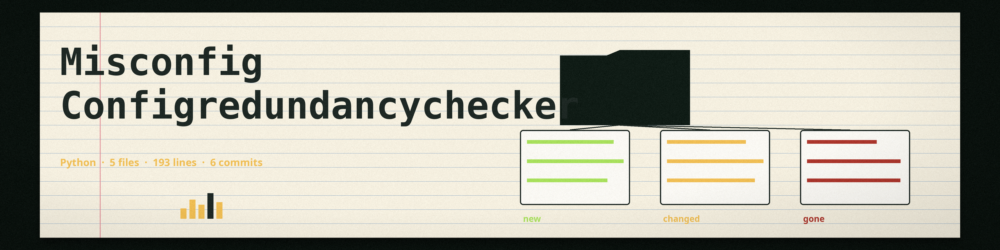

# misconfig-ConfigRedundancyChecker
Detects duplicate configuration keys. A key is reported when it is repeated inside a single mapping, including a true duplicate written twice in the source file, which is detected from the raw document before a parser can collapse it. The same key name used in two different sections, such as `host` under both `database` and `cache`, is not a duplicate and is not reported. This tool does not detect parameters that have no effect because of other parameters, and it does not apply general conflict rules between different parameters. - Focused on Check for misconfigurations in configuration files or infrastructure definitions

An empty file, or a file whose content is not a mapping of settings (for example a plain scalar), is not a checked file: the tool prints an error saying no configuration data was checked and exits 1. A file with duplicate keys exits 1 and a checked file with no duplicates exits 0.

## Install
`git clone https://github.com/ShadowStrikeHQ/misconfig-configredundancychecker`
`pip install -r requirements.txt`

## Usage
`python3 main.py file_path [-v]`

## Parameters
- `file_path`: The path to the configuration file (required positional).
- `-h, --help`: Show help message and exit
- `-v, --verbose`: Enable verbose logging.

## License
Copyright (c) ShadowStrikeHQ
